<div align="center">

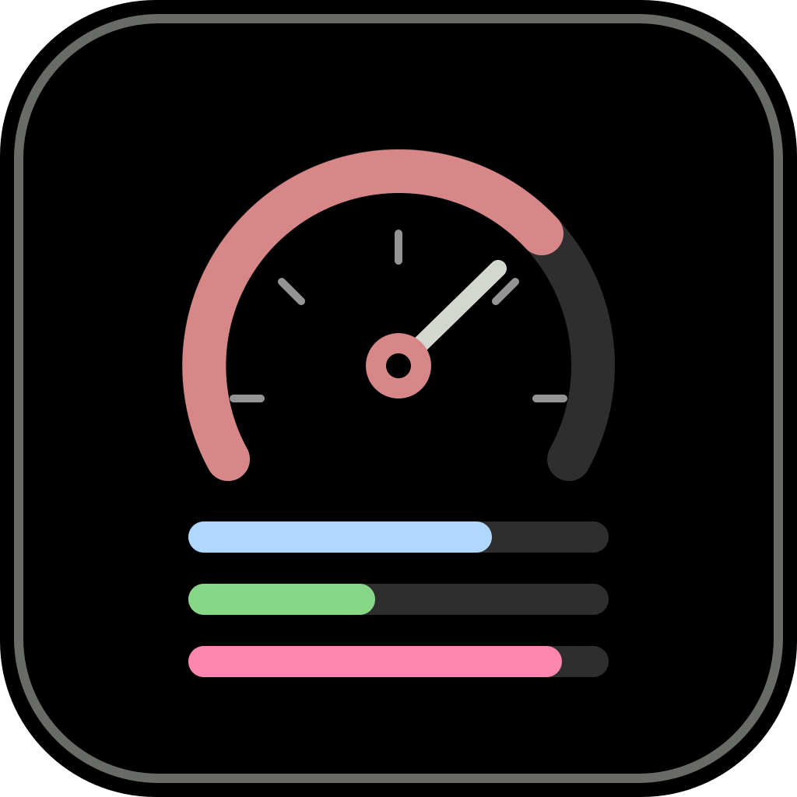

# Flightdeck

**A minimal heads-up display for [Claude Code](https://claude.com/claude-code).**<br>
Every gauge you need, docked beside the chat. Nothing you don't.

[](LICENSE)


[Features](#-features) · [Tour](#-feature-tour) · [Install](#-install) · [Use](#-use) · [Settings](#%EF%B8%8F-settings) · [Develop](#%EF%B8%8F-develop)

</div>

---

<p align="center">
  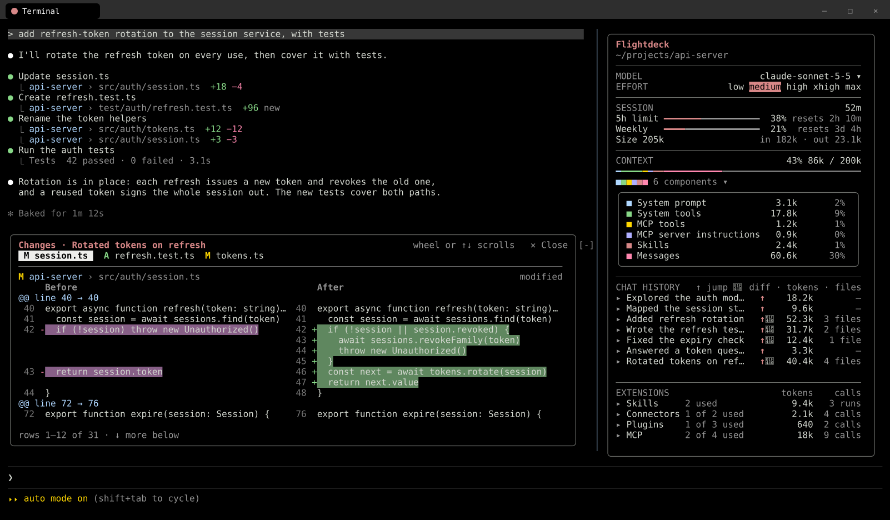
</p>

## ✨ Features

| | Section | What you get |
| :---: | --- | --- |
| 📁 | **Where you are** | The panel's header shows the session's directory. |
| 🎛️ | **Model & effort** | The current model and effort level, highlighted. Click the model to change it; click a level to switch to it. |
| ⏱️ | **Session** | Your 5-hour and weekly plan usage as bars with percentages and reset times, plus the session's size in tokens. |
| 🧠 | **Context** | How full the context window is, coloured by component, with a per-category breakdown that is open by default. |
| 💬 | **Chat history** | One row per response with its title, tokens and files changed. Unfold a row for its opening sentence, a count per repository of files **added**, **modified**, **renamed** and **deleted**, and every tool, MCP server, connector, plugin and skill it used. |
| ↑ | **Jump** | Scrolls the chat straight to that response. |
| 👀 | **Diff viewer** | Opens the response's changes in a box above the prompt that scrolls on its own, side by side: before on the left, after on the right, one tab per file. |
| 🧩 | **Extensions** | How many skills, connectors, plugins and MCP servers the session used, with call counts and an estimate of the tokens each brought into the conversation. |
| ✂️ | **Compact edit rows** | Edits and shell commands stop printing code and diffs into the chat. Each shows what it did and every file it changed, with the lines added and removed. |

## 🔍 Feature tour

From the top of the panel down, then the chat.

### 📁 Where you are

The panel's header names the mod and the directory the session runs in, with your home folder written as `~`. A long path is cut from the front, so the folder you are in stays visible.

<p align="center">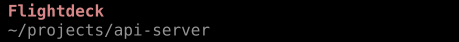</p>

### 🎛️ Model & effort

The model the session runs on, and the effort levels it offers with the one in force highlighted. Click the model to change it, or click a level to switch to it. The panel reads the level Claude Code reports at each tool call and at the end of each response, so it shows what is really in use.

<p align="center">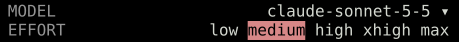</p>

### ⏱️ Session

How long the session has run, your 5-hour and weekly plan usage as bars with percentages and the time until each resets, and the session's size: the tokens sent in and received.

<p align="center">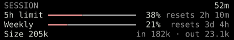</p>

### 🧠 Context

How full the context window is, as a percentage and in tokens, with a bar coloured by what fills it. The breakdown under it lists each part, from the system prompt and tools to the messages, with its tokens and share. It is open by default; click `components` to fold it.

<p align="center">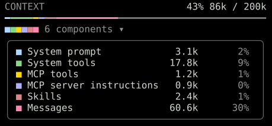</p>

### 💬 Chat history

One row per response, newest last, with its title, the tokens it used and the files it changed. Click `▸` on a row to unfold it: its opening sentence, a count per repository of files **added**, **modified**, **renamed** and **deleted** with the lines changed, and every tool, MCP server, connector, plugin and skill it used.

<p align="center">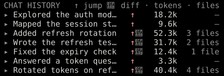</p>

### ↑ Jump

Click `↑` on a row and the chat scrolls straight to that response, however far back it is.

<p align="center">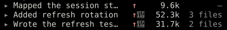</p>

### 👀 Diff viewer

Click `👀` on a row that changed files, and the response's changes open in a box above the prompt, side by side. Each changed file is a tab marked `A` added, `M` modified, `R` renamed or `D` deleted. The selected file shows before on the left and after on the right, with line numbers, and removed and added lines tinted.

The title, the file tabs and the column headings stay fixed while the wheel and arrow keys scroll the code under them, so the chat stays where it is. A footer shows which rows are in view. Every file shows exactly what that one response changed, whether Claude edited it with a tool or a shell command did. `✕ Close` hides the viewer.

<p align="center">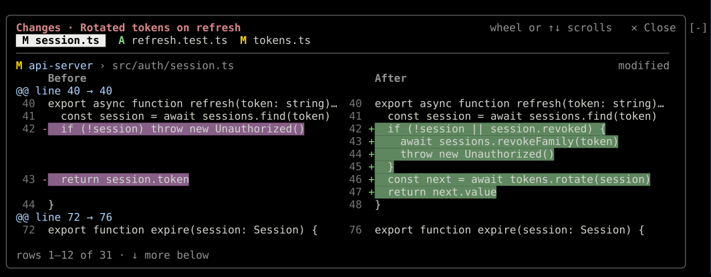</p>

### 🧩 Extensions

What the session has used beyond the built-in tools: skills, connectors, plugins and MCP servers. Each row says how many were used, out of how many are available, with an estimate of the tokens their calls brought into the conversation and the number of calls. Click a row to list each one.

<p align="center">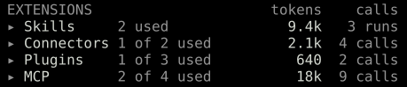</p>

### ✂️ Compact edit rows

Edits and shell commands stop printing code and diffs into the chat. Each one becomes a short row that says what was done, then lists every file it changed, with its repository and the lines added and removed. A shell command's own output, such as a test run's results, still shows; only its script and file diff are folded away. Press `ctrl+o` any time to see the full change.

<p align="center">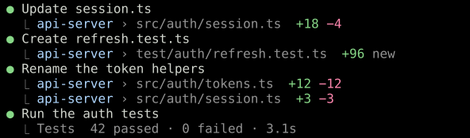</p>

## 📦 Install

At the prompt of a Claude Code terminal session:

```sh
/plugin install flightdeck --marketplace kd411/flightdeck
```

Answer `y` to add the marketplace, then pick a scope. The user scope loads it in every session.

<details>
<summary><b>From a shell, or the desktop app</b></summary>

<br>

From a shell:

```sh
claude plugin install flightdeck --marketplace kd411/flightdeck
```

In the desktop app, where `/plugin` does not run: click **+** next to the prompt box, then **Plugins**, **Add marketplace** with `kd411/flightdeck`, then **Add plugin**.

</details>

## 🕹️ Use

| Do this | To |
| --- | --- |
| `/flightdeck` | Show or hide the panel. It opens by itself at session start when the terminal is wide enough. |
| Click **▸** on a chat row | Unfold what that response did. |
| Click **↑** | Jump to the response in the chat. |
| Click **👀** | Open the side-by-side diff viewer for that response. |
| `ctrl+x` then `tab` | Focus the panel and drive it with the arrow keys and Enter. |
| `/flightdeck debug` | Print what the mod can see of the model and effort controls, for bug reports. |

### 🖥️ Screen sizes

The panel sizes itself to the room it is given, from laptop terminals to ultrawide ones.

| Terminal width | What happens |
| --- | --- |
| **144+** columns | The panel docks on the right at session start. |
| **110–143** columns | The panel docks on the right once you run `/flightdeck`. |
| **Under 110**, or not fullscreen | `/flightdeck` shows a short glance above the prompt: model, effort, context, limits and the last three responses. |

Docked, the panel asks for 46 columns and never takes more than 45% of the terminal. You can drag the dock to resize it.

## ⚙️ Settings

Change these in `/config`:

| Setting | Default | Effect |
| --- | :---: | --- |
| Compact edit rows | ✅ on | Turn off to get Claude Code's normal diffs back in the chat. |
| Open the panel at session start | ✅ on | Turn off to open the panel only with `/flightdeck`. |

## 🪶 Light by design

> [!TIP]
> **Flightdeck makes zero model calls and adds nothing to Claude's context.**

- 📊 Usage, limits and context figures are the ones Claude Code already tracks.
- 🧮 The context breakdown is estimated locally, with no request, and only while the panel is shown with the breakdown open.
- 📝 Chat titles and summaries come from the response's own text.
- 🔒 It never changes your prompts, the system prompt or tool results.
- 🏠 It sends nothing anywhere. On disk it keeps only the last effort level seen per model, written only when that level changes. It runs no git and writes nothing to your repositories.

## 🧭 Limitations

<details>
<summary><b>Good to know before you rely on it</b></summary>

<br>

- **Plan usage** (5-hour and weekly) only exists on a Claude subscription. On API-key billing those rows are hidden.
- **Model and effort clicks** use Claude Code's own settings. Where a setting cannot be changed from a mod, clicking the model opens the `/model` picker instead, and the effort row is hidden if no effort control is available.
- **Jump to response** scrolls the fullscreen chat. A response that was cleared or compacted away cannot be reached.
- **Files changed by shell commands** (a script, `sed`, a formatter) are read from the per-command diff Claude Code records for each shell command, so the mod runs no git and writes nothing to your repository. Claude Code lists up to 200 files per command, with line diffs for the first few; the rest are counted without line figures. A move (`mv`) shows as a delete and an add, not a rename.
- **The diff viewer** opens in the band above the prompt, which Claude Code caps at half the terminal's height; mods have no way to cover the whole chat. Claude Code also draws its own `[-]` beside the band, which folds it (`ctrl+x ctrl+a` unfolds it). Diffs are kept for the last 20 responses and the first 600 lines of each file.
- **Repository names** come from the nearest `.git` folder above the file. A file outside any repository is listed under its folder name.
- **Token figures in Extensions** are estimates, at about four characters a token, of the text each call brought into the conversation. A skill counts its instructions only the first time it loads in a session.
- **The mod API is early access** and may change between Claude Code releases. Built and tested against Claude Code 2.1.326.

</details>

## 🛠️ Develop

```sh
git clone https://github.com/kd411/flightdeck
claude --plugin-dir ./flightdeck     # run it from the folder, hot-reloading on save
claude plugin validate ./flightdeck  # check the manifest and hooks
claude plugin test ./flightdeck      # run the tests
```

<details>
<summary><b>Project layout</b></summary>

<br>

| File | Role |
| --- | --- |
| `hooks/register.tsx` | Wires Claude Code events to the pieces below. |
| `hooks/panel.tsx` | Draws the Flightdeck panel. |
| `hooks/viewer.tsx` | Draws the diff viewer. |
| `hooks/diff.ts` | Reads diffs and lays them out side by side. |
| `hooks/rows.tsx` | Draws the compact rows for edits and shell commands. |
| `hooks/engine.ts` | Every call that asks Claude Code for something. |
| `hooks/state.ts` | The values the panel and viewer draw from. |
| `hooks/lib.ts` | Pure helpers: formatting, counting, classifying. |
| `types/index.d.ts` | The state contract. |
| `docs/` | The README's pictures, and `mockup.py`, which draws them all from made-up data: `python3 docs/mockup.py docs`. |
| `.claude-plugin/icon.png` | The plugin's icon, rendered at 1024 × 1024 from `docs/icon.svg`. |
| `tests/flightdeck.test.tsx` | Tests. |

</details>

Contributions are welcome. See [CONTRIBUTING.md](CONTRIBUTING.md).

---

<div align="center">
<sub>Released under the <a href="LICENSE">MIT License</a>.</sub>
</div>
