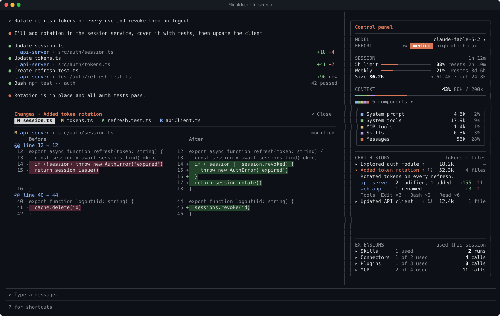
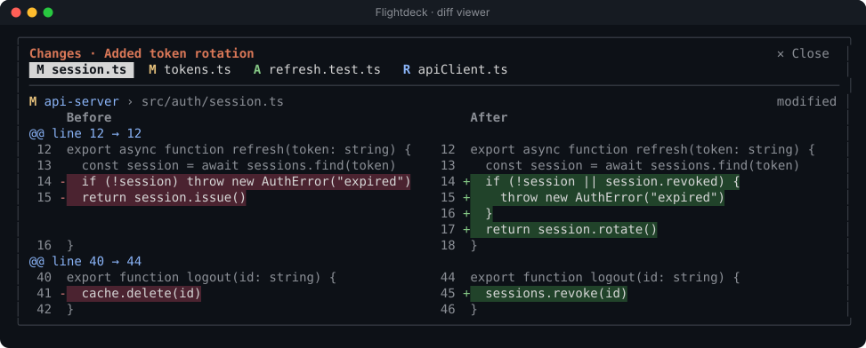

<div align="center">

# ✈️ Flightdeck

**A minimal heads-up display for [Claude Code](https://claude.com/claude-code).**<br>
Every gauge you need, docked beside the chat. Nothing you don't.

[](LICENSE)


[Features](#-features) · [Install](#-install) · [Use](#-use) · [Settings](#%EF%B8%8F-settings) · [Develop](#%EF%B8%8F-develop)

</div>

---

<p align="center">
  
</p>

<details>
<summary><b>The control panel as text</b></summary>

```
╭──────────────────────────────────────────────╮
│ Control panel                                │
│ ──────────────────────────────────────────── │
│ MODEL                        claude-fable ▾  │
│ EFFORT              low  medium  high  max   │
│ ──────────────────────────────────────────── │
│ SESSION                                47m   │
│ 5h limit ━━━━━━━━━━━━━━━━━━━━  38%  resets 2h│
│ Weekly   ━━━━━━━━━━━━━━━━━━━━  21%  resets 3d│
│ Size 205k                in 182k · out 23.1k │
│ ──────────────────────────────────────────── │
│ CONTEXT                       43% 86k / 200k │
│ ━━━━━━━━━━━━━━━━━━━━━━━━━━━━━━━━━━━━━━━━━━━━ │
│ ■■■■■ 5 components ▾                         │
│ ──────────────────────────────────────────── │
│ CHAT HISTORY    ↑ jump 👀 diff · tok · files │
│ ▸ Explored the auth mod   ↑    18.2k       — │
│ ▾ Rotated tokens on serv  ↑ 👀 52.3k 3 files │
│   Added rotation on every refresh.           │
│   api-server  2 modified, 1 added  +155 −11  │
│   Tools  Bash ×2 · Read ×6                   │
│ ──────────────────────────────────────────── │
│ EXTENSIONS                 used this session │
│ ▸ Skills      2 used                  3 runs │
│ ▸ Connectors  1 of 2 used            4 calls │
│ ▸ MCP         2 of 4 used           11 calls │
╰──────────────────────────────────────────────╯
```

</details>

## ✨ Features

| | Section | What you get |
| :---: | --- | --- |
| 🎛️ | **Model & effort** | The current model and effort level, highlighted. Click the model to change it; click a level to switch to it. |
| ⏱️ | **Session** | Your 5-hour and weekly plan usage as bars with percentages and reset times, plus the session's size in tokens. |
| 🧠 | **Context** | How full the context window is, coloured by component, with a per-category breakdown that is open by default. |
| 💬 | **Chat history** | One row per response with its title, tokens and files changed. Unfold a row for its opening sentence, a count per repository of files **added**, **modified**, **renamed** and **deleted**, and every tool, MCP server, connector, plugin and skill it used. |
| ↑ | **Jump** | Scrolls the chat straight to that response. |
| 👀 | **Diff viewer** | Opens the response's changes in the chat, side by side: before on the left, after on the right, one tab per file. |
| 🧩 | **Extensions** | How many skills, connectors, plugins and MCP servers the session used, with call counts. |
| ✂️ | **Compact edit rows** | Edits stop printing diffs into the chat. Each one becomes a single glanceable row. |

Here is what an edit looks like in the chat:

```diff
● Update session.ts
  ⎿ api-server › src/auth/session.ts                          +18 −4
● Create refresh.test.ts
  ⎿ api-server › test/auth/refresh.test.ts                    +96 new
```

Press `ctrl+o` any time to see the full change.

### 👀 Diff viewer

Click `👀` on a chat history row and the response's changes open in the chat, side by side. Each changed file is a tab marked `A` added, `M` modified, `R` renamed or `D` deleted; the selected file shows before on the left and after on the right, with line numbers and removed and added lines tinted.

<p align="center">
  
</p>

Every file shows exactly what that one response changed, whether Claude edited it with a tool or a shell command did. Long diffs page with `‹ Previous` and `Next ›`, and `✕ Close` hides the viewer.

## 📦 Install

At the prompt of a Claude Code terminal session:

```sh
/plugin install flightdeck --marketplace kd411/flightdeck
```

Answer `y` to add the marketplace, then pick a scope. The user scope loads it in every session.

<details>
<summary><b>From a shell, or the desktop app</b></summary>

<br>

From a shell:

```sh
claude plugin install flightdeck --marketplace kd411/flightdeck
```

In the desktop app, where `/plugin` does not run: click **+** next to the prompt box, then **Plugins**, **Add marketplace** with `kd411/flightdeck`, then **Add plugin**.

</details>

## 🕹️ Use

| Do this | To |
| --- | --- |
| `/flightdeck` | Show or hide the panel. It opens by itself at session start when the terminal is wide enough. |
| Click **▸** on a chat row | Unfold what that response did. |
| Click **↑** | Jump to the response in the chat. |
| Click **👀** | Open the side-by-side diff viewer for that response. |
| `ctrl+x` then `tab` | Focus the panel and drive it with the arrow keys and Enter. |
| `/flightdeck debug` | Print what the mod can see of the model and effort controls. |

### 🖥️ Screen sizes

The panel sizes itself to the room it is given, from laptop terminals to ultrawide ones.

| Terminal width | What happens |
| --- | --- |
| **144+** columns | The panel docks on the right at session start. |
| **110–143** columns | The panel docks on the right once you run `/flightdeck`. |
| **Under 110**, or not fullscreen | `/flightdeck` shows a short glance above the prompt: model, effort, context, limits and the last three responses. |

Docked, the panel asks for 46 columns and never takes more than 45% of the terminal. You can drag the dock to resize it.

## ⚙️ Settings

Change these in `/config`:

| Setting | Default | Effect |
| --- | :---: | --- |
| Compact edit rows | ✅ on | Turn off to get Claude Code's normal diffs back in the chat. |
| Open the panel at session start | ✅ on | Turn off to open the panel only with `/flightdeck`. |

## 🪶 Light by design

> [!TIP]
> **Flightdeck makes zero model calls and adds nothing to Claude's context.**

- 📊 Usage, limits and context figures are the ones Claude Code already tracks.
- 🧮 The context breakdown is estimated locally, with no request.
- 📝 Chat titles and summaries come from the response's own text.
- 🔒 It never changes your prompts, the system prompt or tool results.
- 🏠 It sends nothing anywhere. On disk it keeps only the last effort level seen per model, and its own git index inside each repository it watches.

## 🧭 Limitations

<details>
<summary><b>Good to know before you rely on it</b></summary>

<br>

- **Plan usage** (5-hour and weekly) only exists on a Claude subscription. On API-key billing those rows are hidden.
- **Model and effort clicks** use Claude Code's own settings. Where a setting cannot be changed from a mod, clicking the model opens the `/model` picker instead, and the effort row is hidden if no effort control is available.
- **Jump to response** scrolls the fullscreen chat. A response that was cleared or compacted away cannot be reached.
- **Files changed by shell commands** (a script, `sed`, a formatter) are found by snapshotting the session repository's working tree before and after each response. It uses git with an index file of its own (`.git/flightdeck.index`), so your staging area is never touched; the snapshots leave unreferenced objects that `git gc` clears. Shell edits in other repositories are not counted.
- **The diff viewer** opens as a row at the end of the chat, not as a window over it; Claude Code gives mods no way to cover the chat. Diffs are kept for the last 20 responses and the first 600 lines of each file. Every file shows exactly what that response changed, deleted files included.
- **Repository names** come from the nearest `.git` folder above the file. A file outside any repository is listed under its folder name.
- **The mod API is early access** and may change between Claude Code releases. Built and tested against Claude Code 2.1.325.

</details>

## 🛠️ Develop

```sh
git clone https://github.com/kd411/flightdeck
claude --plugin-dir ./flightdeck     # run it from the folder, hot-reloading on save
claude plugin validate ./flightdeck  # check the manifest and hooks
claude plugin test ./flightdeck      # run the tests
```

<details>
<summary><b>Project layout</b></summary>

<br>

| File | Role |
| --- | --- |
| `hooks/register.tsx` | Wires Claude Code events to the pieces below. |
| `hooks/panel.tsx` | Draws the control panel. |
| `hooks/viewer.tsx` | Draws the diff viewer. |
| `hooks/diff.ts` | Reads diffs and lays them out side by side. |
| `hooks/rows.tsx` | Draws the compact edit row. |
| `hooks/engine.ts` | Every call that asks Claude Code for something. |
| `hooks/state.ts` | The values the panel draws from. |
| `hooks/lib.ts` | Pure helpers: formatting, counting, classifying. |
| `types/index.d.ts` | The state contract. |
| `docs/` | The README's pictures, drawn from made-up sample data. |
| `tests/flightdeck.test.tsx` | Tests. |

</details>

Contributions are welcome. See [CONTRIBUTING.md](CONTRIBUTING.md).

---

<div align="center">
<sub>Released under the <a href="LICENSE">MIT License</a>.</sub>
</div>
